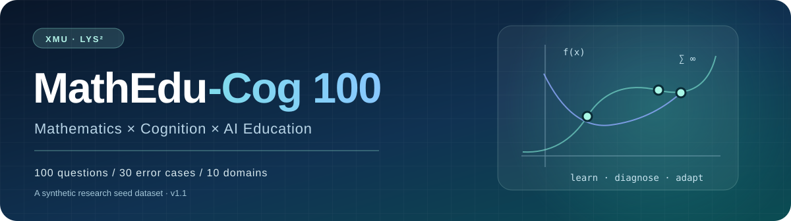
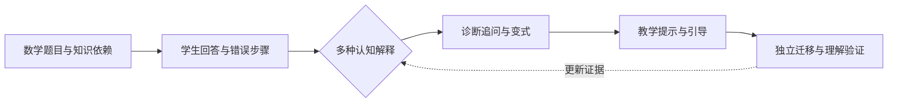

<div align="center">



### 数学教育认知诊断合成种子数据集

**From correct answers to evidence of understanding.**  
面向数学教育 AI 的题目、错误推理、认知假设、诊断追问与教学策略数据。

[](#项目概览)
[](#项目概览)
[](#数据内容)
[](#快速开始)
[](#数据边界与研究伦理)

[**在线浏览（启用 Pages 后）**](https://xmulyssmathsoc.github.io/mathedu-cog-100/) · [题库数据](data/) · [30 道错误案例](docs/30道错误案例详解.md) · [数据文档](docs/DATASET_CARD.md) · [复现指南](docs/REPRODUCE.md)

</div>

---

## 一眼认识 MathEdu-Cog 100

数学教育中的困难不止于“题目答错了”。学生也可能答对结论，却不理解定义和推理；可能记住一种解法，却无法迁移到相近的问题。**MathEdu-Cog 100** 用可追溯的结构化数据表示这些情境，帮助研究 AI 如何观察、诊断、追问、引导和验证数学理解。

| 100 道核心题目 | 30 个详细错误案例 | 80 个数学概念节点 | 10 个领域 |
|:---:|:---:|:---:|:---:|
| 5 个相对难度等级 | 错误步骤与可能原因 | 诊断题与教学提示 | 初中、高中、大学基础数学 |


> [!IMPORTANT]
> **这是 AI 合成的研究原型，不是真人学生数据集。** 所有学生作答与多轮交互均为人工设计的数学情境、语言模型创作或脚本化模拟；未运行早期弱模型，也未经过真实学生实验校准。模型推断的“误区”只能视为候选解释，不能作为学生认知诊断结论。自动数学检查不能替代完整的专家审核。

## 项目概览

### 这套数据关注什么？



该项目基于 **MathEdu-Cog** 的结构化标注设计，记录题目知识、标准解法、错误模式、候选认知误区、伪理解风险、诊断追问、教学干预、合成交互及偏好比较。目标服务于三类 AI 研究任务：**题目认知标注生成、学生认知诊断和自适应数学教学**。

## 数据内容

| 内容 | 规模 | 在哪里查看 |
|---|---:|---|
| 核心题目 | **100** | `data/question_catalog.json` · `docs/100道题完整标注版.md` |
| 详细模拟错误案例 | **30** | `data/error_cases_30.jsonl` · `docs/30道错误案例详解.md` |
| 概念节点 | **80** | `data/canonical_records.jsonl` 中 `concept` 类型 |
| 原始规范记录 | **2,081** | `data/canonical_records.jsonl` |
| 增强记录总量 | **2,111** | 上述规范记录 + 30 个案例 |
| 核心题题族拆分 | **70 / 15 / 15** | train / validation / synthetic_test |

**数学领域覆盖：** 数与运算、代数与方程、函数与图像、几何与解析几何、三角函数与向量、概率与组合、统计、微积分、线性代数、逻辑与证明。

30 个深入案例涵盖连续百分比变化、方程增根、定义域遗漏、逻辑量词、概率基率、置信区间、连续与可导、矩阵可对角化等典型情境。每个案例都包含一段模拟错误推理、第一处错误、候选认知原因、诊断题、纠正方法及迁移检查。

## 快速开始

### 方式 A：网页浏览，无需安装数据库

打开仓库根目录 `index.html` 即可浏览全部 **100 道题目 + 30 道错误案例**：支持关键词搜索、难度和领域筛选、错误步骤和教学方案详情。网页数据已嵌入 HTML，可直接离线打开；在线加载 MathJax 时公式排版更完整。

如果希望公开在线展示，可以在仓库 **Settings → Pages** 选择 **Deploy from a branch → main → /(root)**，部署后 `index.html` 将作为网站首页。此步骤需要仓库管理者手动启用 Pages。

### 方式 B：直接查询 SQLite

无需第三方依赖：

```bash
python scripts/query.py --id CAL-003
python scripts/query.py --domain PRO --difficulty 3 --limit 8
python scripts/query_error_cases.py --id EC-022
```

SQLite 示例：

```sql
SELECT id, domain_code, difficulty, stem, correct_answer
FROM questions
ORDER BY id LIMIT 10;

SELECT case_id, item_id, domain_code, title
FROM error_cases
ORDER BY case_id;
```

### 方式 C：复现构建和数据验证

```bash
python -m pip install -r requirements.txt
python scripts/rebuild_v11.py
python scripts/build_site.py
python tests/smoke_test.py
```

数据库构建、规范记录、训练数据导出与主要检查脚本都在 `scripts/` 中。具体命令及已知局限见 [复现指南](docs/REPRODUCE.md)。

## 用于 AI 训练

分割后训练视图存于 `exports/train/`，验证与合成测试视图分别在 `exports/validation/` 和 `exports/synthetic_test/`。**不要将 `exports/*.jsonl` 根目录下的全量汇总文件直接当作训练集。**

| 训练视图 | 任务 |
|---|---|
| `cognitive_diagnosis_sft.jsonl` | 从回答形成多个可能认知假设 |
| `tutoring_sft.jsonl` | 根据交互选择下一步教学行动 |
| `label_generation_sft.jsonl` | 为新数学题生成认知标注 |
| `teaching_preferences.jsonl` | 比较不同教学决策的规范性质量 |
| `error_case_analysis_sft.jsonl` | 深入分析错误步骤及候选原因 |
| `error_case_tutor_sft.jsonl` | 基于详细错误场景生成教学反馈 |

这些数据可用于**训练流程验证、合成任务原型和方法研究**，但不应视为已经验证的真实学生分布或最终基准测试集。

## 仓库结构

```text
mathedu-cog-100/
├── index.html                 # 精心设计的离线/Pages 题库网站
├── assets/                    # 品牌视觉、网站样式、交互与预览
├── data/
│   ├── mathedu_cog_100.sqlite # 完整 SQLite 数据库
│   ├── canonical_records.jsonl
│   ├── question_catalog.json
│   └── error_cases_30.jsonl
├── docs/                      # 100 题、30 案例、字段与研究文档
├── schema/                    # JSON Schema 与 SQL DDL
├── exports/                   # 三个独立拆分下的训练/验证视图
├── scripts/                   # 数据生成、查询、检查与建站
├── tests/                     # 数据集冒烟测试
├── reports/                   # 质量报告和已知局限
└── .github/workflows/         # GitHub CI 检查
```

## 数据边界与研究伦理

1. **来源真实可追溯：** 学生回答全部标记为合成，无真实学生个人信息，不会把 AI 模拟误称为真人实验。
2. **认知诊断有不确定性：** 学生行为和内在认知状态分开表示；一条错误答案不足以证明某个误区。
3. **数学核验有限：** 100 道核心题和 30 个详细错误案例已进行针对性程序检查，但未完成全部自然语言证明的独立专家评审。
4. **分割严格隔离：** 相关题目族沿用同一 train/validation/synthetic_test 划分；合成测试不能替代真人测试。
5. **后续研究需实证：** 研究真实学生的误区发生率、教学有效性和跨人群泛化前，需要获得合适的真实教育数据与审核。

详见 [Dataset Card](docs/DATASET_CARD.md) 和 [研究边界](docs/RESEARCH_ETHICS.md)。

## 参与改进

欢迎教育研究者、数学教师、开发者和 AI 研究者参与题目审核、错误模式标注、实验方法与真实数据校准。请先阅读 [贡献指南](CONTRIBUTING.md) 并使用 GitHub Issues 说明具体题目 ID、证据与修改建议。

**维护者：** XMU LYS² MathSoc（厦门大学乐亦思数社团）  
**联系邮箱：** [xmulyssmathsoc@proton.me](mailto:xmulyssmathsoc@proton.me)

**授权状态：** 尚未确定公开复用许可证。公开可见不自动等于获得复制、修改或商业使用许可。正式对外推广和二次训练前应确定代码与数据的授权方案，参见 [授权说明](docs/LICENSING.md)。

---

<div align="center">
  <sub>Built to study mathematical understanding, not just mathematical answers.</sub>
</div>
